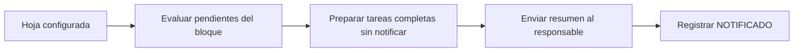

# Notificación automática de tareas en Google Sheets

[Guía visual actual con capturas (PDF)](docs/portafolio/Guia_Visual_Actual.pdf) · [Procedencia y alcance de las muestras](docs/portafolio/README.md)

**Automatización con Google Apps Script que detecta entregas completas y avisa por correo para continuar el seguimiento de la tarea.** Es un proyecto personal de Jimmy Toapanta orientado a reducir revisiones repetitivas de una hoja operativa.

[Lectura de portafolio y evidencia](PORTFOLIO.md) · [GestorCompras](https://github.com/eslay07/GestorCompras) · [Perfil del autor](https://github.com/eslay07)

## Qué hace y con qué tecnología

La implementación usa **JavaScript en Google Apps Script**, `SpreadsheetApp` y `MailApp`. No utiliza Python ni lee Outlook.

1. Recorre las hojas incluidas en el mapa de destinatarios.
2. Localiza bloques entre `PENDIENTE ENTREGA` y `DELIMITADOR` en la columna D.
3. Busca hacia arriba el número de tarea de nueve dígitos en la columna B.
4. Revisa los pendientes del bloque y omite una tarea cuya columna H ya contiene `NOTIFICADO`.
5. Envía un resumen por hoja mediante correo.
6. Después del envío correcto, marca las tareas como `NOTIFICADO`.

## Estructura de entrada esperada

| Elemento | Ubicación leída por el código |
| --- | --- |
| Número de tarea | Columna B, en una fila anterior al bloque; nueve dígitos |
| Inicio y final del bloque | Columna D: PENDIENTE ENTREGA y DELIMITADOR |
| Cantidad pendiente de cada línea | Columna D, entre los delimitadores |
| Estado de aviso | Columna H de la fila de la tarea |
| Destinatario | Mapa `emailPorHoja`, según nombre de la hoja |

Las columnas adicionales pueden usarse en la hoja, pero estas posiciones son las que consume esta versión del script.

## Configuración y prueba

1. Cree una copia de prueba de su hoja con datos sintéticos y la estructura anterior.
2. Abra **Extensiones → Apps Script** y copie [Tareas_finalizadas.gs](Tareas_finalizadas.gs).
3. Ajuste `emailPorHoja` con los nombres de sus hojas y un destinatario de prueba propio. No publique direcciones reales en GitHub.
4. Ejecute `verificarTareasCompletas` y revise los permisos solicitados por Google antes de concederlos.
5. Compruebe que una tarea pendiente no se notifica, una completa se notifica y queda marcada, y una segunda ejecución no vuelve a enviar la ya marcada.
6. Cuando haya validado el comportamiento, configure un activador temporal con la frecuencia adecuada a su operación y a las cuotas disponibles de su cuenta.

Una ejecución real envía correo y modifica el estado de la hoja. Las comprobaciones deben hacerse primero con recursos de prueba.

## Integración con GestorCompras

Este script detecta el hito de entrega completa y genera el aviso. [GestorCompras](https://github.com/eslay07/GestorCompras) puede usar la notificación como entrada para revisar y preparar la reasignación de tareas. Son proyectos complementarios, no la misma aplicación ni una dependencia que se instale automáticamente.

## Límites y mejoras pendientes

- La estructura y los destinatarios deben configurarse para cada instalación.
- La expresión actual `parseFloat(valor) || 0` interpreta datos vacíos o no numéricos como cero. Se debe validar la calidad de los datos; no equivale a una validación estricta de cantidades.
- El marcado reduce reenvíos habituales, pero no incluye un bloqueo de concurrencia para ejecuciones simultáneas.
- No hay una suite local de pruebas automatizadas en este repositorio. La lista anterior es un protocolo manual de verificación.
- No se publica una medición de ahorro ni una garantía de entrega de correo; el resultado depende de los datos, permisos y cuotas de Google.

## Código y documentación

- [Código fuente](Tareas_finalizadas.gs): `verificarTareasCompletas` y `buscarTareaFila`.
- [Evidencia y alcance del proyecto](PORTFOLIO.md).
- [Manual integral existente](documentacion/Manual_Integral_Notificacion_Tareas.pdf).
- [Procedencia del repositorio](PROVENIENCIA.md).

## Autor

**Jimmy Toapanta** · [LinkedIn](https://www.linkedin.com/in/jimmy-toapanta-950a441b8/) · [Portafolio](https://github.com/eslay07)

Consulte [LICENSE](LICENSE).
